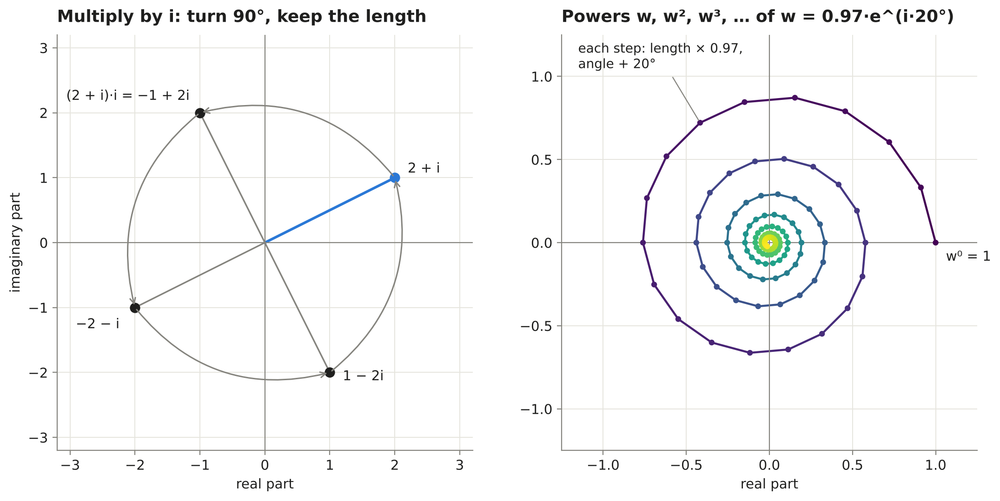
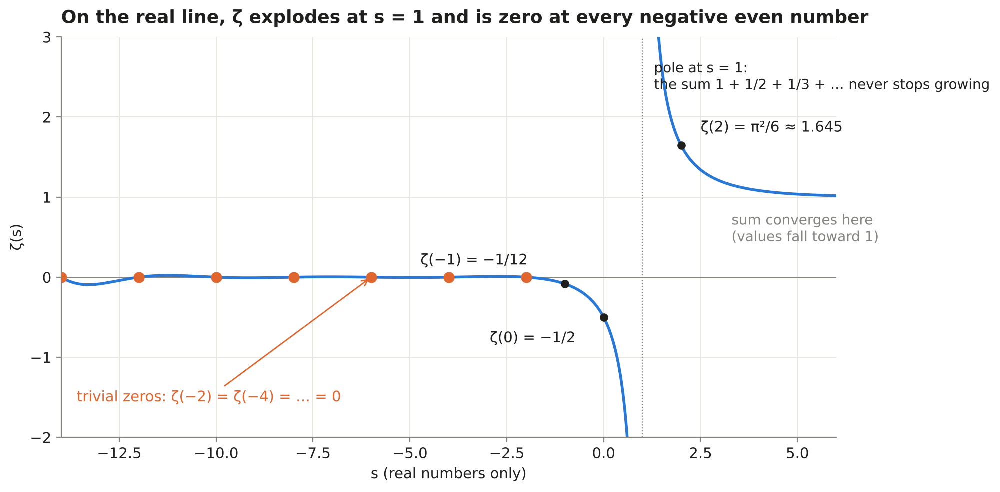
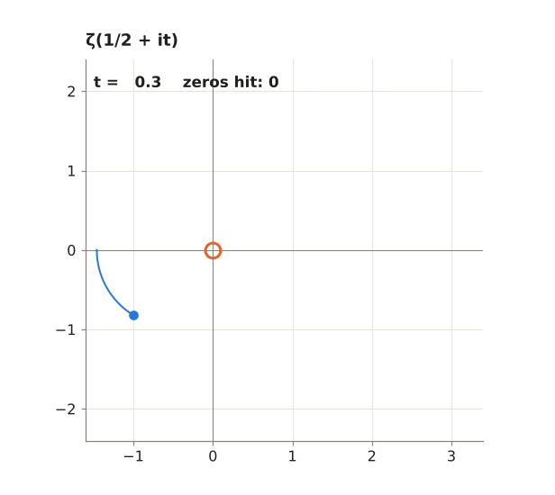
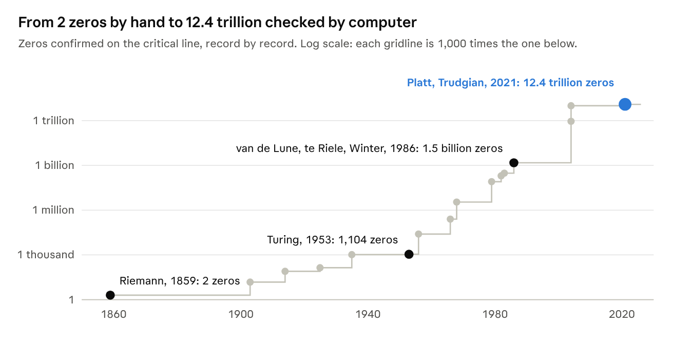

## Why one guess from 1859 still matters

How many prime numbers are there below a given number? The guess itself sounds tiny. It says that certain special points, called zeros, all sit on one straight line. Why would anyone care about points on a line? Because those points control the primes. They decide how evenly the primes are spread among the whole numbers.

Mathematicians did not wait for a proof. They kept building on the guess anyway. Hundreds of theorems now begin with "assume the Riemann hypothesis is true." Think of them as floors of a tall building, resting on a foundation nobody has checked. Prove the guess, and every floor becomes solid on the same day. Disprove it, and they all come down. That is why I say: if RH is proved, math rediscovers itself.

The question feels closer than ever right now. In 2026, AI systems proved weaker versions of the guess. Claims of a full proof keep appearing too, but none has been accepted yet. So this felt like the right moment to ask: what exactly is this guess, and why does it matter so much?

This post answers that with pictures. You only need to know what a function is and what an infinite sum is. Every image comes from a short Python script you can run yourself, and the last section shows how.

## Complex numbers: points that spin

A complex number is a point on a flat plane. You write it a + bi. The a says how far right, and the b says how far up. The letter i is a new number with one rule: i × i = −1.

Adding two complex numbers just moves you around: (2 + i) + (1 + 3i) = 3 + 4i. Multiplying is where the patterns come from. When you multiply, the lengths multiply and the angles add. Example: (1 + i) × (1 + i) = 2i. Each 1 + i has length √2 and angle 45°. The product has length 2 and angle 90°, which is the point 2i.

One more fact makes the rest of this post work. Take a whole number n and a complex number s = σ + it. Then the power n−s is an arrow with:

- length n−σ, so the real part σ shrinks the arrow
- angle −t × ln n, so the imaginary part t spins the arrow

### How to see a complex function

A complex function takes a point and returns a point. A true graph would need four dimensions, so we use colour instead. Domain colouring [colour shows the output's angle] paints each input point by the angle of its output. Light and dark bands show the output's size. A zero is easy to spot: every colour meets at one point.

 = z³ − 1 is zero at the three cube roots of 1. Each zero shows up as a small colour wheel.")

## The zeta function and the critical strip

The zeta function adds one over every whole number, each raised to a power s:

$$
\zeta(s) = 1 + \frac{1}{2^s} + \frac{1}{3^s} + \frac{1}{4^s} + \cdots
$$

Example: input s = 2, output 1 + 1/4 + 1/9 + … = π²/6 ≈ 1.645. Euler found this in 1734.

For a complex s, each term is one of the spinning arrows from the last section. Lay them tip to tail, and the chain spirals in to the answer.

.")

The sum only works when the real part of s is above 1. Riemann found a way to extend ζ to every complex number except s = 1. This is analytic continuation (the one smooth extension). There is only one smooth way to fill in the rest, so the new values are not a choice.

On the real line, the extended ζ has two clear features. It explodes at s = 1, because 1 + 1/2 + 1/3 + … grows without limit. And it is zero at −2, −4, −6 and every other negative even number. These are the trivial zeros (easy zeros on the negative axis).

Every other zero lives in a narrow band called the critical strip (real part between 0 and 1). Riemann computed the first few of these zeros by hand. All of them sat exactly on the middle line of the strip, where the real part is 1/2. He guessed that every one of them does. That guess is the Riemann hypothesis.

> **The Riemann hypothesis.** Every zero of ζ(s), other than the trivial zeros, has real part exactly 1/2.

Figure 5 is the main picture of this post. It paints ζ over a tall slice of the plane, using the colour code from figure 2. The colour wheels on the dashed line are zeros. Not one wheel sits off it.

 for real parts from −9 to 9 and heights from −4 to 34. Zeros on the critical line appear at heights 14.13, 21.02, 25.01, 30.42 and 32.94.")

There is also a mirror rule. The functional equation (links ζ(s) with ζ(1 − s)) reflects every zero across the line Re(s) = 1/2. So a zero at 0.7 + 50i would force a twin at 0.3 + 50i. RH says no such twins exist. Every zero sits alone, on the mirror itself.

## Where the primes hide, and why 1/2 matters

Why should primes care about a line in the complex plane? Riemann wrote down an exact formula for counting primes. It starts with a smooth curve and adds one wave for each zero.

The cleanest prime count is ψ(x) (primes counted with log weights). It adds log p for every prime power pk up to x. Example: input x = 10, output log 2520 ≈ 7.83, because 2, 3, 4, 5, 7, 8 and 9 add log 2 + log 3 + log 2 + log 5 + log 7 + log 2 + log 3. Its graph is a staircase that steps up at every prime power.

Riemann's explicit formula rebuilds that staircase exactly:

$$
\psi(x) = x - \sum_{\rho} \frac{x^{\rho}}{\rho} - \log\, 2\pi - \tfrac{1}{2}\log\left(1 - x^{-2}\right)
$$

The sum runs over every zero ρ in the strip. Each zero adds one wave. Figure 6 adds the waves in batches.

. The blue curve is Riemann's formula with 0, 10, 100 and 1,000 zeros. With 1,000 waves, a sharp step appears at every prime.")

Here is why the number 1/2 matters. A zero with real part σ makes a wave about xσ tall. If every zero has σ = 1/2, every wave is only about √x tall. Then the primes never stray far from the smooth curve. A single zero at σ = 0.8 would make a wave x0.8 tall and swamp all the others.

So RH is a statement about fairness. It says the primes are spread out as evenly as they possibly can be.

Figure 7 shows the same idea from the zeta side. Follow ζ up a vertical line as the height t grows. On the line σ = 1/2, the path runs through 0 at each zero. Move to σ = 0.65, and the loops look alike but always miss.

 passes through 0 seven times below t = 42. Right: ζ(0.65 + it) never does. Colour marks the height t.")

The animation below (a01_zeta_spiral.gif in the code package) traces the left path live and counts each hit.

Figure 8 tests the prediction against real primes. Gauss guessed that li(x) (Gauss's smooth estimate of π(x)) tracks π(x), the number of primes up to x. In 1976, Lowell Schoenfeld proved that if RH is true, the gap between them stays below √x · ln x / 8π. The real gap stays well inside that ceiling. At x = 10⁸ the gap is 754, while the ceiling is 7,329.

 − π(x). The dashed orange line is the ceiling RH guarantees. Both axes use a log scale.")

## Trillions of checks, and why they are not a proof

So why is this not a proof? There are infinitely many zeros, and 12 trillion is still 0% of them. Every table ever computed shows π(x) &lt; li(x).

## Sources

- [The Riemann hypothesis is true up to 3·10¹²](https://arxiv.org/abs/2004.09765v1), David Platt and Timothy Trudgian
- [A computational history of prime numbers and Riemann zeros](https://arxiv.org/pdf/1810.05244), the verification milestones
- [Mathlib source: RiemannZeta.lean](https://raw.githubusercontent.com/leanprover-community/mathlib4/master/Mathlib/NumberTheory/LSeries/RiemannZeta.lean), the Lean statement of RH
- [Formalizing zeta and L-functions in Lean](https://arxiv.org/html/2503.00959v4), David Loeffler and Michael Stoll
- [Anthropic: Claude and the Riemann zeta function](https://anthropic.com/research/riemann-zeta), the 41.6% to 67.2% bound
- [Quanta Magazine: AI proved the quasi-Riemann hypothesis](https://quantamagazine.org/ai-proved-the-quasi-riemann-hypothesis-what-happens-now-20261019), the 1/8–7/8 and 1/12–11/12 results
